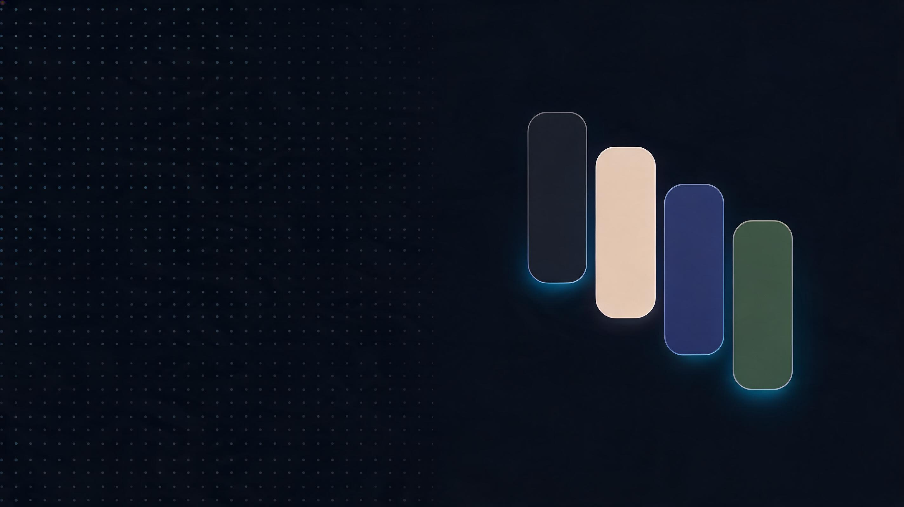
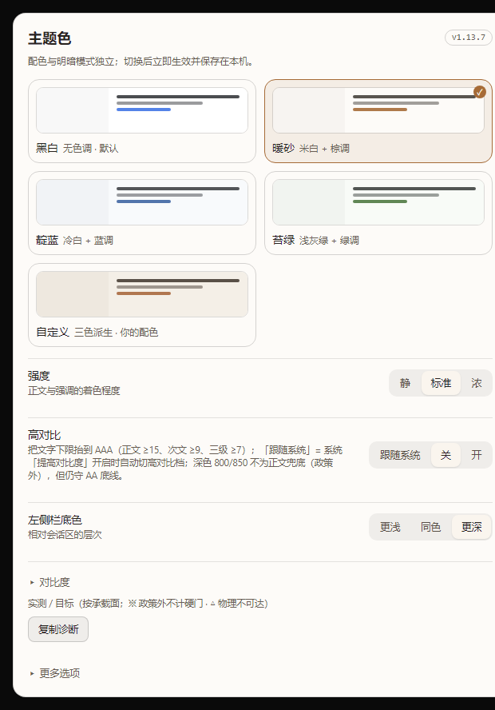
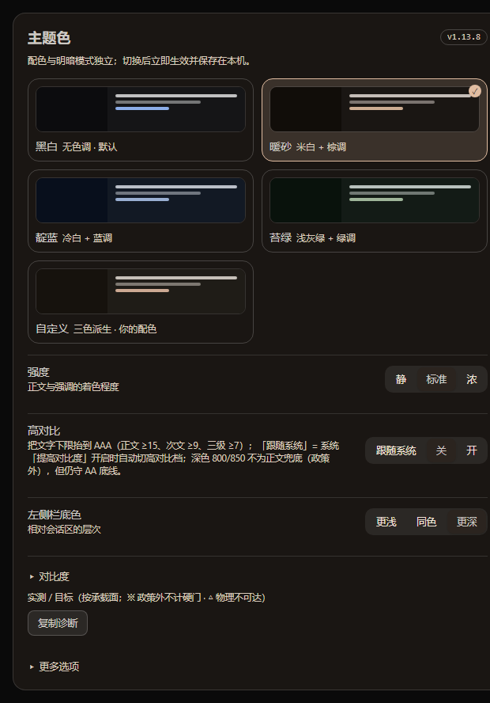
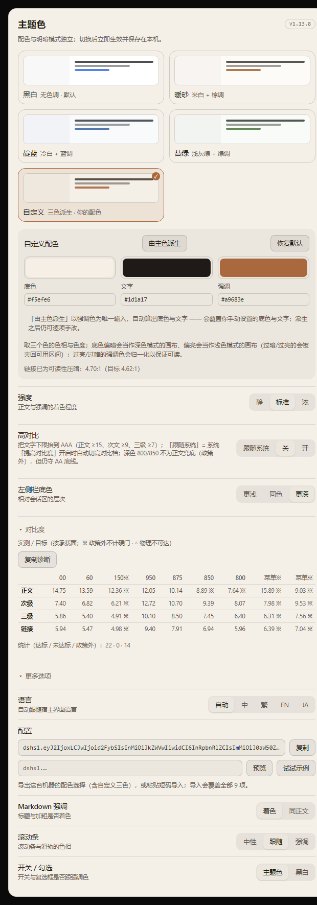
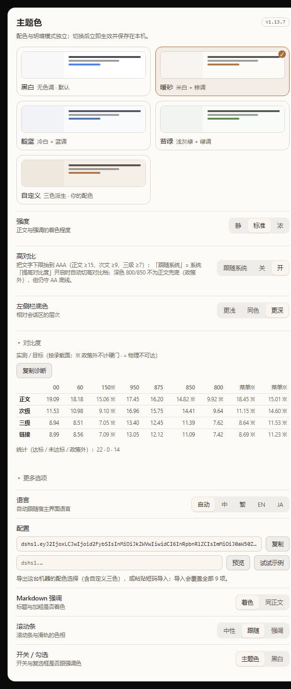

# dsh-theme-palette 推介文（知乎长文 + 平台短文案）



> 文中「配图」均指仓库内的真实截图（`assets/screenshot-settings-*.png`），发布时上传即可。
> 所有数字（token 数、对比度、门禁项）都来自插件仓库本身，可复核。

---

## 标题候选（三选一）

1. **给 AI 编程工具做一套「读得下去」的配色：我写了个 DSH 配色插件**
2. **一个配色插件，和它踩过的四个坑**
3. **我把「对比度承诺」做进了配色引擎——顺带逮到 30 个漏覆盖的颜色**

（副标题建议：DeepSeek Harness 主题配色 dsh-theme-palette，4 套预设 + 自定义，明暗独立。）

---

## 正文

### 一、先说痛点

用 AI 编程工具的人，大概都有过这几个瞬间：

- 深色模式下正文其实只有 6:1 出头，看两小时眼睛发酸，但「看起来」好像挺白；
- 换了一套配色，按钮、链接、diff 的 `+` / `−` 行却还是原来那套蓝和绿；
- 想调成自己喜欢的底色，设完之后发现「好像没变」——因为底色只被当成色相来源，明度是写死的；
- 侧栏、卡片、气泡明明都是同一个 token 体系，偏偏某一块永远是默认灰。

DeepSeek Harness（下称 DSH）是跑在本地的 AI 编码客户端，界面是一套基于 CSS 变量的 token 体系。我每天在里面待四个小时以上，上面这些坑一个没落地踩了个遍。于是这个插件从一开始就不是「换几张色卡」，而是**把整套颜色按对比度重新算一遍**。

现在的版本是 1.13.5，四个预置（黑白 / 暖砂 / 靛蓝 / 苔绿）+ 自定义，明暗两个轴完全独立。

**配图 1**（设置页：五套配色、强度、面板表面）



**配图 2**（深色 / 自定义 / 高对比）





> 四张都在仓库 `assets/` 下（620px 宽，真实静态渲染）。发布到知乎/小红书时需要先把图片上传到平台，再把 markdown 引用换成平台图床。
> **还缺一张「深色模式下的对话正文」实拍**（最有说服力的一张，需要你在 GUI 里自己截）。

### 二、它不是主题包，是「重算」

大多数主题插件做的事是：挑一组色值，覆盖 `--bg`、`--text`、`--accent` 几个变量，完事。

DSH 的颜色不是这么组织的。它的界面由一套 **token 引用链**驱动：语义别名（`--dsw-alias-bg-base`、`--dsw-alias-label-primary`……）引用静态色阶（`--dsw-static-neutral-bluish-950` 这类），组件再引用别名。所以「只改几个变量」的结果就是：改了画布，卡片还是原来的灰；改了正文，注释和三级文字纹丝不动。

插件的做法是把**整条色阶重建**：

```
OKLCH(L, C, hue) ──► 色域钳位（对 C 二分） ──► sRGB hex
        ▲
        └── 角色色度 × 强度，再在 {画布, 卡层, 侧栏, 悬浮层} 上求解对比度
```

- 明度保留、色相与色度按角色重给：近白端略压暗（纯白上不了色），正文只给极低色度（保证字形锐利），深色底给足色度；
- 色域钳位是真的二分到 sRGB 边界，不是「超了就裁一刀」；
- 每一个承载面（画布 / 卡片 / 侧栏 / 悬浮层）上的文字单独求解对比度。

效果是：**192 个颜色 token（179 个宿主 token + 13 个插件自有，黑白档 19 个），1080 组配置全扫描**。更关键的是下面这条——

> 构建后的 CSS 里真正被 `var()` 消费的颜色 token 有 **66 个**，现在**全部**能落到插件声明的值上。
> 这个数字不是写文案时估的，是 `tools/check-host-contract.mjs` 从宿主构建里解出来逐条对账的；
> 拿 1.13.4 的代码跑同一条断言会挂 **30 处**。

### 三、三条设计取舍

#### 1. 对比度是「承诺」，不是「感觉」

插件对每种文字角色都给了硬下限：

| 角色 | 浅色 | 深色 | 高对比 |
|---|---|---|---|
| 正文 | 12:1 | 10:1 | 15:1 |
| 次级 | 6.2:1 | 8:1 | 9 / 9.6 |
| 三级 | 4.85:1 | 6.4:1 | 7 / 7.6 |
| 链接 | 4.95:1 | 4.62:1 + APCA Lc ≥ 60 | 7 / 75 |

深色侧比浅色侧要求更高，因为 WCAG 的比值在暗底上会系统性高估可读性——同样是 4.62:1，亮底大约相当于 APCA Lc 71，暗底只有 48。所以深色链接额外过一道 APCA 亮度闸（标准档 60、高对比 75）。

这些数字**在文字真正落到的承载面上实测**，不是拿设计稿的底色算。承诺面是浅色 00/60、深色 950/875；深色 800（模块面）与 850（次级深面）不为正文兜底，报表里单列为「政策外」——既不算达标，也不算失败，但每一面仍要过 AA 的 4.5 底线。

#### 2. 语义色只换「温度」，不换明度

这是 1.13.5 才补上的一块，也是最容易做错的地方。

宿主除了中性色阶，还并列着**红 / 绿 / 琥珀三族语义色阶**。以前插件只重建四族中性色阶，于是「步骤点 done/error/warning、`data-tone` 标签、终端错误行、无效输入边框、危险菜单项悬停、文件 diff 的 +/− 行」在自定义配色下永远是宿主默认的纯红纯绿纯琥珀——这正是「好多颜色还是默认色」的来源，一共 39 个 token。

现在的做法是**温度调和**：色相往配色的色相拉，但**旋转封顶 8°**；色度压到 88–92%；**明度一律沿用宿主**。

封顶这件事很关键。苔绿配色的色相是 162°，「短路径」会把红（OKLCH h≈28°）往橙推十几度，报错就和警告撞色了。封到 8° 之后，红还是红、绿还是绿、琥珀还是琥珀，只是「同一件语义色换了冷暖」。纯黑白灰的自定义配色不做调和——语义色一个像素都不动。

#### 3. 「底色」要当真的底色用

自定义配色只让你选三个颜色：底色、文字、强调。

旧版本里，底色只被当**色相来源**：深色画布明度写死 L≈0.226。你把底色设成 `#070b11`（L≈0.148），屏幕上出现的是 `#191c21` 一档的蓝灰——你会觉得「底色没变」，而这个判断是对的。

现在：底色偏暗（L ≤ 0.35）就当作**深色模式的画布明度**（夹到 0.14–0.30）；偏亮（L ≥ 0.75）当作**浅色模式的画布明度**（0.90–0.985）；中间灰不表达明暗意图，两侧都沿用引擎值。只锚画布这一档，其余三层面按同一 delta 平移（层次间距不变），文字对比度在新承载面上重算。

线条色同理：以前取的是文字色的 alpha，文字一旦接近中性，发丝线就是一片灰。现在自定义配色下线条改用配色色相 + 色度下限 0.02，明度与 alpha 不变。

### 四、四个踩坑故事

#### 坑 1：一块永远不变的深灰卡片

会话列表悬停会弹出一张小卡片（标题 / 时间 / 状态）。它一直是深灰 `#2C2C2E`，而且**浅色模式下也是深灰**。

我一开始以为是「浮层没吃到主题变量」，改了一版把表面别名显式落地——没用，还是深灰。

真正定位靠的是一张对照：把浅色和深色两套截图并排量像素。**同一个颜色在两套主题下逐像素相同**，说明它跟主题毫无关系。顺着这条线去翻宿主构建：`dsh-web-frontend` 的 CSS 里有一行

```css
._card_38jqx_9{ --dsw-hovercard-bg: #2C2C2E; background: var(--dsw-hovercard-bg) }
```

——手写字面量，全站唯一的大写 hex，既不读色阶也不读别名。而它的声明落在**卡片元素自身**，所以普通声明压不过，只能 `!important`：

```css
*{ --dsw-hovercard-bg: var(--dsh-tp-hovercard-bg, #2c2c2e) !important }
```

顺手补的一句经验：**判断一个元素跟不跟主题，先比明暗两套截图**，颜色不随模式变，就别去改 token 了。

（这张卡最终仍是深色提示卡——宿主的设计就是「暗底白字」，我只把它接回配色的暗面，让它带上配色色相。浅色模式下要不要也变浅，涉及卡片内部三层文字色，属于另一个取舍，暂时没做。）

#### 坑 2：以为「改色阶就够了」

宿主的别名大多是 `var(--dsw-static-neutral-bluish-NN)` 的引用，看起来很美好：改色阶，别名自动跟随。

但总有几处不跟随。1.13.3 的做法是把宿主里**47 个「纯粹是色阶引用」的别名**在覆盖层里直接写成色阶值，不再依赖中间引用。结果对「能正常替换的地方完全一致（同一档）」，对不生效的地方就是修复——这类改动没有副作用，只有确定性。

#### 坑 3：APCA 的 Lc 全是整数

APCA 用来做感知对比度。插件的 `apcaContrast` 返回的是 `Lc/100`，代码里写的是：

```js
return Math.round(out * 100) / 100
```

`out` 本身就是 `Lc/100`，所以这行等价于「把 Lc 取整后再除 100」——引擎吐出来的每一个 Lc 都是整数。后果是「把颜色顶到 Lc ≥ 60」的循环在量化后的 60 就停了，真实值可能是 59.77。

更妙的是审计报告给的修法：`Math.round(out * 10000) / 100`。照抄一跑，`raiseToLc` 里的 ×100 换算变成了 ×1，算出来的「Lc」是 **−4708**，深色链接当场被压暗，色觉缺陷断言直接变红。正确分母是 10000。

这条我印象最深：**报告里的修复建议也要验算**。

#### 坑 4：把质量门改坏，门全绿

做审计时做过一组变异测试：把对比度底线 `CONTRAST_FLOOR` 从 4.5 改成 1.0，然后跑全套门禁——**全绿**。

原因是断言里的期望值来自同一个函数：常量改了，期望值跟着改，门就在空转。

修法很土但有效：**把承诺写成字面量**。

```js
check(CONTRAST_FLOOR === 4.5, ...)
check(MIN_LINK_DARK === 4.62, ...)
```

再补一条「独立复算」：拿渲染出来的 token 现算物理上限，而不是读被测代码自己算的字段。现在同一组变异（4.5 → 1.0）会红在第一条断言上。

### 五、工程面：能被复核的才算数

一个配色插件最容易骗人的地方，是「看起来对」。所以这套东西的门禁做得比较重：

- **1080 组配置全扫描**：5 套配色 × 216 组设置，标准档与高对比档各跑一遍，硬失败退出码 1；
- **宿主契约**：从宿主真实构建里解出插件依赖的 token 名与 DOM 钩子，宿主改名会红，而不是静默失效；
- **颜色覆盖守卫**：66 个被 CSS 消费的颜色 token，逐条要求「插件声明」或「var 链落到插件声明的 token」；
- **变异测试**：改坏实现看门会不会红——现在会；
- **发布走 npm Trusted Publishing**（OIDC + provenance），不打长期 token。

另外几个使用面的细节：`/theme-palette` 斜杠命令一键切配色；自定义配色可以导出成 `dshs1.` 短码（三色也带走），换机器导入即可；界面四语（简中 / 繁中 / 英 / 日）；宿主如果丢掉覆盖层，自愈会重放，连续失败会停下并在设置页给「重新启用」按钮。

### 六、边界：不做什么

- **不做玻璃、壁纸、动效。** 那条赛道靠截图竞争，这个插件靠证据。
- **不改宿主源码**，只通过 `ctx.theme.overrideTokens` 叠一层 token。
- **不替宿主改语义色的明暗节奏。** 宿主把「成功绿当文字」放在浅色下只有约 2.1:1（diff 的 `+` 行、success 标签），而这一族是明暗同值单档，任何靠调明度补对比度的做法都会在另一侧反噬。所以语义色只换冷暖，不动明度——这条写在 README 的覆盖口径里。
- 右栏不染色：宿主那块面板是整高透明覆盖层，上色会盖住主栏（1.9.10 起整条链路撤除）。

### 七、安装

```bash
cd ~/.dsh/profiles/desktop
pnpm add dsh-theme-palette
```

装完**重启 GUI**（运行中的进程仍持旧模块）。入口：头像 → 设置 → 主题色。

- npm：https://www.npmjs.com/package/dsh-theme-palette
- 仓库（含完整设计文档 `docs/DESIGN.md`、变更记录 `CHANGELOG.md`、六语 README）：https://github.com/zuoyunlai/dsh-theme-palette

### 结尾

配色这件事，外行看是审美，内行看是数学：色域、明度、对比度、色觉缺陷、语义色的可辨性，每一条都能被算错，也每一条都能被复核。

这个插件到目前为止改过 30 多个版本，其中一大半不是加功能，而是「把上一个版本没算对的地方算对」。如果你也在 DSH 里长时间待着，欢迎试试；配色偏好很个人，不满意就直接在设置里调，或者用自定义三色。

---

## 平台短文案

### 小红书（≤600 字，配 3 张图）

**标题**：给 AI 编程工具换了套「算出来的」配色

每天在 DeepSeek Harness 里待 4 小时，眼睛先受不了了：深色正文看着白，其实只有 6:1。

于是写了个配色插件，不是换色卡，是把整条色阶按 OKLCH 重建、在文字真正落到的面上求解对比度：
· 4 套预设（黑白 / 暖砂 / 靛蓝 / 苔绿）+ 自定义，明暗独立
· 正文承诺浅色 12:1 / 深色 10:1，链接深色另过 APCA Lc ≥ 60
· 192 个颜色 token 全量覆盖，1080 组配置扫描
· 语义色（报错红 / 成功绿 / 警告琥珀）也跟着配色换冷暖，但色相旋转封顶 8°，不会红绿撞色
· 支持导出 `dshs1.` 短码，换机器直接导入

装法：`cd ~/.dsh/profiles/desktop && pnpm add dsh-theme-palette`，重启 GUI，头像 → 设置 → 主题色。

#DeepSeekHarness #配色 #深色模式 #效率工具

### 微博 / 即刻（≤200 字）

给 DSH 写了个配色插件：4 套预设 + 自定义，明暗独立。不是换色卡，是把整条色阶按 OKLCH 重算、在真实承载面上求解对比度（正文浅 12:1 / 深 10:1，深色链接另过 APCA Lc 60）。192 个颜色 token 全覆盖，1080 组配置扫描，语义色也只换冷暖不换明度——报错还是红，只是跟着配色变暖或变冷。
`pnpm add dsh-theme-palette`，重启即用。

### V2EX / 掘金（技术向，≤300 字）

分享一个 DSH 配色插件（开源，MIT）。

它不是换色卡：把宿主 4 族静态色阶按 OKLCH 重建、做真色域钳位，然后在每个承载面上逐一求解文字对比度（浅 12:1 / 深 10:1，链接深色另加 APCA Lc ≥ 60）。1.13.5 补上了宿主 red/green/amber 三族语义色——只做温度调和（色相旋转 ≤8°、色度 88–92%、明度沿用宿主），所以报错/成功/警告不会串色。

工程面比较重：1080 组配置扫描、宿主契约测试（token 名与 DOM 钩子）、颜色覆盖守卫（构建 CSS 真正消费的 66 个颜色 token 逐条对账）、以及一组变异测试确保质量门真的会红。

`pnpm add dsh-theme-palette` / GitHub: zuoyunlai/dsh-theme-palette

---

## 小红书长文版（约 1400 字，适合「长文」模式发布）

**标题**：每天在 AI 编程工具里坐 4 小时，我给它做了一套「算出来的」配色

**正文**：

先说结论：这不是一个换色卡的插件，是把界面里每一档颜色按对比度重新算一遍。

我在 DeepSeek Harness（一个跑在本地的 AI 编码客户端）里每天待四个小时以上。用得越久，越觉得颜色这事不对劲：

深色模式看着挺舒服，但正文实际只有 6:1 出头，看久了眼睛发酸。

换了一套配色，按钮、链接、diff 的红绿行还是原来那套。

想把底色调成自己喜欢的深蓝，设完发现「好像没变」——因为底色只被当色相来源，明度是写死的。

于是我从「换色卡」改成了「重算」。

**它到底做了什么**

界面颜色不是几个变量，而是一条 token 引用链：语义别名引用静态色阶，组件再引用别名。

所以只改几个变量，结果必然是「改了画布，卡片还是原来的灰」。

插件的做法是把整条色阶重建：OKLCH 空间里重建，做真色域钳位，然后在文字真正落到的每个承载面上单独求解对比度。

现在的规模是：192 个颜色 token，1080 组配置全扫描。

**五个我觉得值得说的点**

1. 对比度是承诺，不是感觉

正文浅色 12:1、深色 10:1（高对比 15:1）；次级 6.2 / 8；三级 4.85 / 6.4；链接 4.95 / 4.62。

深色侧为什么要求更高？因为 WCAG 的比值在暗底上会高估可读性——同样 4.62:1，亮底约等于 APCA Lc 71，暗底只有 48。所以深色链接另过一道 APCA Lc ≥ 60。

这些数字是在文字真实落到的面上实测的。

2. 语义色只换「温度」，不换明度

报错红、成功绿、警告琥珀，这三个颜色以前永远是宿主默认值。

现在它们跟着配色走，但只是「换冷暖」：色相旋转封顶 8°，色度压到 88–92%，明度一律不动。

为什么封顶？苔绿配色会把红往橙推十几度，报错就和警告撞色了。封到 8°，红还是红。

3. 自定义配色的「底色」，终于当底色用

旧版本里，底色只影响色相，画布明度固定。

你把底色设成 #070b11，屏幕上出现的是 #191c21——觉得没变，这个判断是对的。

现在：底色偏暗就当作深色画布的明度，偏亮就当作浅色画布的明度，中间灰不表达意图，其余层面按同一差值平移。

4. 线条色不再是一片灰

以前线条色取文字色的透明度，文字一接近中性，发丝线就成了中性灰。

现在自定义配色下线条改用配色的色相，明度与透明度不变。

5. 语义色、标签、错误行、diff 行，全都跟着配色

1.13.5 才补上的一块：宿主有红/绿/琥珀三族语义色阶，以前插件从没碰过，一共 39 个 token 停在默认色。

**两个踩坑故事**

一是那块永远不变的深灰卡片。

会话列表悬停会弹出一张小卡，颜色一直是 #2C2C2E——浅色模式下也是深灰。

我先按「浮层没吃到主题变量」修了一版，没用。

真正定位靠一张对照：把浅色和深色两套截图并排量像素。同一个颜色在两套主题下逐像素相同，说明它跟主题毫无关系。

翻宿主构建，果然有一行手写字面量把底色钉死了。它的声明落在卡片元素自己身上，普通写法压不过，只能强行接管。

经验：判断一个元素跟不跟主题，先比明暗两套截图。

二是质量门骗了我。

做审计时做了个变异测试：把对比度底线从 4.5 改成 1.0，跑全套门禁——全绿。

因为断言里的期望值来自同一个函数，常量改了，期望值跟着改，门在空转。

修法很土：把承诺写成字面量。现在同样一组改动，门会红。

**安装**

npm 装，重启 GUI，头像 → 设置 → 主题色。

`cd ~/.dsh/profiles/desktop && pnpm add dsh-theme-palette`

四套预设（黑白 / 暖砂 / 靛蓝 / 苔绿）+ 自定义，明暗独立；还能导出成短码换机器用。

**边界**

不做玻璃、壁纸、动效。

不改宿主源码。

语义色的明度沿用宿主——所以宿主本身「浅色下成功绿当文字只有 2.1:1」这个问题，我不替它改，改了会在深色侧反噬。

配色很个人，不满意就自己调，或者用自定义三色。

**标签**：#DeepSeekHarness #AI编程 #配色 #深色模式 #开源项目 #效率工具
