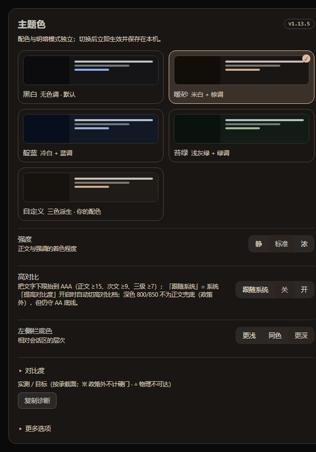
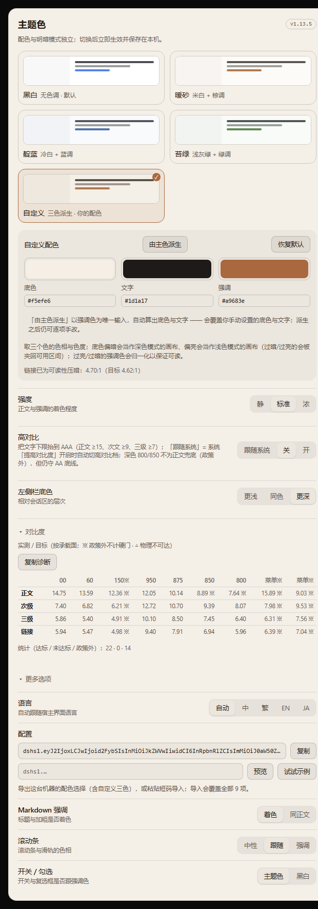
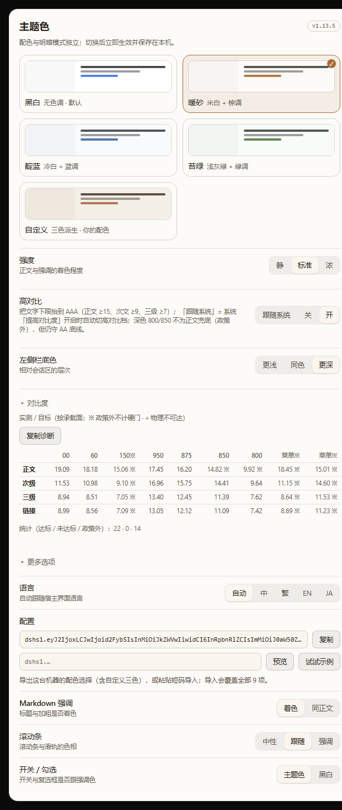

# dsh-theme-palette

[English](README.md) · [中文](README-zh.md) · [日本語](README-ja.md) · [Español](README-es.md) · [Português](README-pt.md) · [हिन्दी](README-hi.md)

Paleta de tema para o DeepSeek Harness (web e desktop): **4 paletas predefinidas + personalizada × claro/escuro**, dois eixos independentes.


*Render estático na largura real do painel (564 px de conteúdo).*

| Escuro | Paleta personalizada | Alto contraste |
|---|---|---|
|  |  |  |

## Compatibility

| Superfície | Estado |
|---|---|
| Cliente DSH desktop / web | 0.2.x |
| Node.js | 22.19.0+ (na linha 22.x) ou 24.0.0+ |
| Alterações no código do host | nenhuma |

O campo `engines` do pacote é `^22.19.0 || >=24.0.0` — a linha acima é o mesmo requisito por extenso.

O plugin apenas empilha tokens de cor via `ctx.theme.overrideTokens`; não registra um tema, não altera o host e não toca na preferência de aparência.

## What it does

- **4 predefinidas + personalizada** — Mono, Areia quente, Índigo, Musgo (cada uma adaptada de forma independente ao claro e ao escuro), mais uma paleta personalizada derivada de três cores;
- a escala é **recalculada** por completo: reconstrução OKLCH → croma por papel → **limite de gamut sRGB** → contraste resolvido sobre superfícies reais;
- tokens de cor do host: 179 nas paletas com tinta (+13 do próprio plugin), 19 na mono (1080 combinações de ajuste escaneadas); **os 66 tokens de cor que o CSS compilado realmente consome resolvem todos no plugin**: texto, secundário, terciário, legendas, links, barras laterais, cartões, balão do usuário, botão primário, barras de rolagem, interruptores, títulos/negrito de Markdown, blocos de código e agora **os estados de erro/sucesso/aviso e as linhas +/− do diff** (as escalas vermelho/verde/âmbar entram pela primeira vez na reconstrução: só temperatura, rotação de matiz limitada a 8°);
- ajustável: intensidade do texto (3), profundidade da barra lateral (3), ênfase de Markdown, barras de rolagem, cor dos interruptores;
- **paleta personalizada** (escolha superfície / texto / acento: a matiz do texto entra na derivação e uma superfície claramente escura ou clara vira a luminosidade do canvas daquele modo — o motor mantém as garantias de contraste), **exportação/importação de configuração** por um código `dshs1.`, **modo de alto contraste** e **4 idiomas de interface**;
- **autorrecuperação**: se o host descartar a camada de override, a paleta é reaplicada; após falhas repetidas a autorrecuperação pausa e a página de ajustes oferece um botão para reativá-la;
- **promessas de contraste**: o corpo tem a promessa de 12:1 no claro e 10:1 no escuro (15:1 em alto contraste), o secundário ≥ 6.2 no claro e 8.0 no escuro (HC 9 / 9.6), o terciário ≥ 4.85 no claro e 6.4 no escuro (HC 7 / 7.6), os links ≥ 4.95 no claro e 4.62 no escuro (HC 7; os pisos do lado claro têm margem para deficiências de visão cromática; os links escuros ainda passam por um portão APCA Lc ≥ 60, 75 em HC), medidos nas superfícies onde o texto realmente cai (o lado escuro precisa de mais: uma razão WCAG superestima a legibilidade sobre fundo escuro);
- as superfícies prometidas são 00/60 no claro e 950/875 no escuro; as escuras 800 (superfície de módulo) e 850 (sub-superfície) **não** sustentam o texto do corpo: o relatório as conta à parte como «fora de política» (nem contam como aprovado nem como falha);
- interface em 简体中文 / 繁體中文 / English / 日本語 (segue o idioma do host e pode ser fixada).

## Install

```bash
# via npm
cd ~/.dsh/profiles/desktop
pnpm add dsh-theme-palette
```

Para fixar uma versão, use `pnpm add dsh-theme-palette@<version>` — o [CHANGELOG.md](CHANGELOG.md) marca as seções que nunca foram publicadas no npm; não fixe uma delas.
A partir do tarball de um release do GitHub: escolha o asset na [página de releases](https://github.com/zuoyunlai/dsh-theme-palette/releases) e instale com `pnpm add <caminho-do-tgz>`.

Depois **reinicie a interface**: um processo em execução mantém o módulo antigo. Abra em avatar → Configurações → **Color theme**.

## Configuration

| Item | Opções |
|---|---|
| Paleta | Mono · Areia quente · Índigo · Musgo (as miniaturas seguem claro/escuro) |
| Intensidade | Suave / Padrão / Forte — quanto o texto segue a paleta |
| Superfícies | Barra lateral (Mais clara / Igual / Mais escura). O painel direito nunca é tingido: é uma camada transparente de altura total, tingi-lo cobriria a conversa (ajuste removido em 1.9.10) |
| Mais opções | Idioma, ênfase de Markdown, barras de rolagem, interruptores |

Cada escolha aplica na hora e fica em `localStorage`. Claro/escuro continua no controle «Aparência» do host.

## Palette engine

```
OKLCH(L, C, matiz) ──► limite de gamut (busca binária em C) ──► hex sRGB
        ▲
        └── croma por papel × intensidade, depois contraste sobre {tela, cartão, barra, sobreposição}
```

- os aliases semânticos mantêm cadeias `var(--dsw-static-neutral-bluish-NN)`, então tudo que segue um token segue a paleta;
- superfícies claras usam os passos 00–300, as escuras 800–950;
- os pisos de texto são exigidos na construção: corpo ≥ 12:1 no claro e ≥ 10:1 no escuro (alto contraste: 15:1), secundário ≥ 6.2 claro / 8.0 escuro (HC 9 / 9.6), terciário ≥ 4.85 claro / 6.4 escuro (HC 7 / 7.6), link ≥ 4.95 claro / 4.62 escuro (HC 7), link com APCA Lc ≥ 60 escuro (HC 75); o texto da barra lateral e do balão segue a escala e mede ≥ 7 (sem portão de contraste próprio);
- as superfícies prometidas são 00/60 no claro e 950/875 no escuro; as escuras 800 (superfície de módulo) e 850 (sub-superfície) **não** sustentam o texto do corpo: o relatório as conta à parte como «fora de política» (nem contam como aprovado nem como falha), e toda superfície ainda precisa passar pelo piso AA de 4.5;
- o relatório separa três coisas: a meta declarada, o teto físico (o que o branco ou o preto alcançam nessa superfície) e a isenção de política; 0.93 é apenas margem do solucionador, usada para decidir se uma meta fica acima do teto;
- `node palette-dev.mjs` verifica 1080 combinações (5 paletas × 216 ajustes, ambos os níveis de contraste incluídos).

Notas de design, critério por componente e tabelas de contraste em [docs/DESIGN.md](docs/DESIGN.md). Histórico: [CHANGELOG.md](CHANGELOG.md).

## Development

```bash
npm run report                        # relatório de tokens de todas as paletas (-- --hc para alto contraste)
npm run sheet                         # painel de paletas → tools/sheet.html
npm run shot-sheet                    # captura do painel (Chrome/Edge headless)
npm run compare -- --dir tools/out/<run>   # comparar com a linha de base local
npm run preview -- --lang en          # renderizar a página de ajustes
npm run contract                      # contrato de tokens/DOM do host (strict: SKIP falha)
npm run release -- --dry              # pré-checagem de release
npm run release -- --tag              # publicar no npm + tag
npm run release -- --ci               # publicação em CI: apenas tag; Actions publica com Trusted Publishing
npm run clean                         # remover tarballs locais / tools/out / dist
```

A regressão visual tem duas camadas: o painel de paletas (sem autenticação) e a janela real do desktop via CDP (`tools/shoot-desktop.mjs`, requer `--remote-debugging-port`). Veja [tools/README.md](tools/README.md).


## Pitfalls we hit

As cinco mais surpreendentes da auditoria da 1.7.0 — cada uma foi encontrada por um teste, não olhando capturas.

- **Um acento branco gerava um link branco** (1.13:1). O solucionador de contraste andava só numa direção, afastando-se do fundo, então um acento mais claro que o fundo continuava indo para o branco.
- **Escolher uma cor mudava a página mas não o painel.** O componente inscrevia-se no id da paleta, que não muda quando a cor muda; o React comparou os snapshots, viu que não havia diferença e pulou o re-render.
- **Compartilhar uma configuração não compartilhava as cores.** O código curto carregava os modos mas não as três cores personalizadas, então importar em outra máquina informava sucesso e mantinha os valores locais.
- **«Não prometido» não é «impossível».** O relatório antigo rotulava as superfícies modulares escuras como «limitado pela superfície», porque comparava a meta do corpo com a mais profunda (800). Mas 800 chega a cerca de 10.22:1 e 850 a cerca de 15.27:1 com um primeiro plano branco, acima da meta de 10:1: nunca foi inalcançável; aquelas superfícies simplesmente não eram prometidas. Agora o relatório separa a meta declarada, o teto físico e a isenção de política, e conta 800/850 como «fora de política» em vez de «fisicamente inalcançável».
- **Um seletor que achávamos morto estava vivo.** A auditoria inicialmente o reportou como quebrado; o teste de contrato contra o CSS publicado provou o contrário. O achado estava errado, não o código.

## Sharing

Toda a configuração — incluindo as três cores personalizadas — viaja num código curto. Cole na caixa de importação e clique em Pré-visualizar para ver exatamente o que mudará antes de aplicar:

```text
dshs1.eyJ2IjoxLCJwIjoiY3VzdG9tIiwicyI6ImRlZXAiLCJ0IjoidGludGVkIiwiYyI6InRpbnRlZCIsImsiOiJhY2NlbnQiLCJtIjoib24iLCJoIjoib2ZmIiwibCI6InpoLUNOIiwieCI6eyJiZyI6IiNmNWVmZTYiLCJ0ZXh0IjoiIzFkMWExNyIsImFjY2VudCI6IiMzZjY2YTMifX0
```

Este exemplo real decodifica para:

- paleta: custom · barra lateral: deep · texto: tinted
- scrollbar: tinted · controles: accent · Markdown: on · alto contraste: off · idioma: zh-CN
- três cores: `#f5efe6` (fundo) · `#1d1a17` (texto) · `#3f66a3` (acento)

O código é gerado pelo codificador de produção e auto-verificado ida e volta antes de entrar neste README — nunca é escrito à mão.

## Trade-offs

Outros plugins de tema aqui entregam vidro, papéis de parede e animação. Decidimos não fazer isso:

- **Sem vidro nem papel de parede.** Essa corrida se ganha com capturas; preferimos competir com provas.
- **Sem mercado de temas nem geração de cor por IA.** Ambos introduzem cores que não podemos garantir; o solucionador de contraste é o ativo.
- **Sem mais paletas.** Quatro predefinições mais um gerador de três cores supera dez escolhidas à mão; volume não é a vantagem.
- **Sem promessas de "proteção ocular".** Reportamos razões medidas nas superfícies onde o texto realmente cai e dizemos «fora de política» quando essa superfície não é uma das prometidas: é uma medição, não uma desculpa.


## License

MIT © 2026 Zuoyunlai
