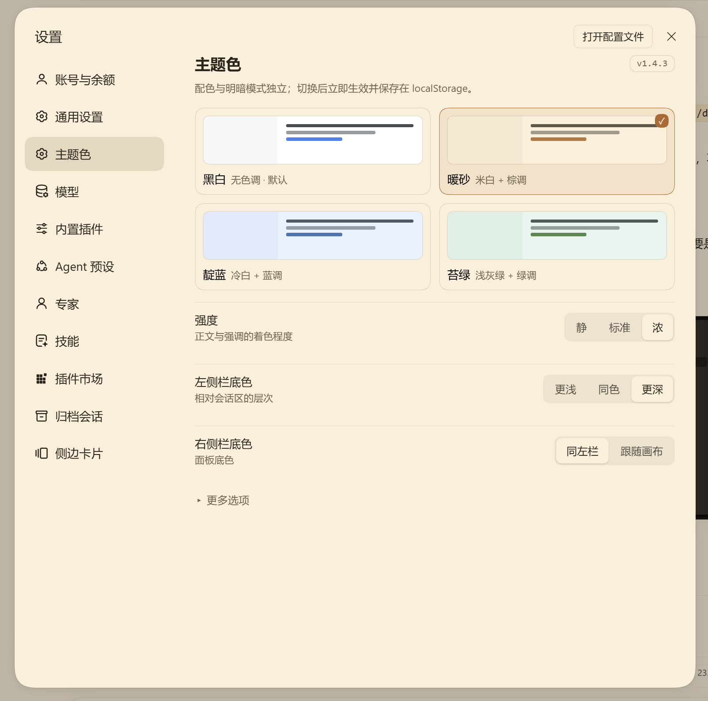

# dsh-theme-palette

[English](README.md) · [中文](README-zh.md) · [Español](README-es.md) · [Português](README-pt.md) · [हिन्दी](README-hi.md)

DeepSeek Harness（Web / 桌面）的主题配色插件：**4 套配色 × 明暗两模式**，两个轴互相独立。



## Compatibility

| 项目 | 状态 |
|---|---|
| DSH 桌面 / Web 客户端 | 0.2.x |
| Node.js | ≥ 20 |
| 对宿主源码的改动 | 无 |

插件只用 `ctx.theme.overrideTokens` 叠一层颜色 token：不注册主题、不改宿主、不动「外观」偏好。

## What it does

- **4 套配色** —— 黑白 / 暖砂 / 靛蓝 / 苔绿，各自独立适配明暗两侧；
- 色阶**整体重算**而不是替换：OKLCH 重建 → 角色化色度 → **sRGB 色域钳位** → 在真实承载面上求解对比度；
- 覆盖 27,000+ 处 token 引用：正文、次级、三级、注释、链接、侧栏、卡片、主人气泡、主按钮、滚动条、开关、Markdown 标题/加粗、代码块；
- 可调：文字着色三档、侧栏三档、右栏两档、Markdown 强调、滚动条、开关配色；
- **自愈**：宿主丢弃 override 层时自动重放；
- 界面支持 简体中文 / 繁體中文 / English / 日本語（跟随宿主，也可手选）。

## Install

```bash
# 从 npm
cd ~/.dsh/profiles/desktop
pnpm add dsh-theme-palette

# 或指定版本
pnpm add dsh-theme-palette@1.4.3
```

从 GitHub Release 的 tarball：

```bash
pnpm add "https://github.com/zuoyunlai/dsh-theme-palette/releases/download/v1.4.3/dsh-theme-palette-1.4.3.tgz"
```

装完**必须重启 GUI**（运行中的进程仍持旧模块）。入口：左下角头像 → **设置** → 「**主题色**」。

## Configuration

| 项 | 选项 |
|---|---|
| 配色 | 黑白 · 暖砂 · 靛蓝 · 苔绿（卡片缩略图跟随明暗） |
| 强度 | 静 / 标准 / 浓 —— 正文与强调的着色程度 |
| 面板表面 | 左侧栏（更浅 / 同色 / 更深）、右侧栏（同左栏 / 跟随画布） |
| 更多选项 | 语言、Markdown 强调、滚动条、开关 / 勾选 |

选择即时生效并存在 `localStorage`；明暗仍由宿主「外观」控制。

## Palette engine

```
OKLCH(L, C, hue) ──► 色域钳位（对 C 二分） ──► sRGB hex
        ▲
        └── 角色色度 × 强度，再在 {画布, 卡层, 侧栏, 悬浮层} 上求解对比度
```

- 语义别名保留 `var(--dsw-static-neutral-bluish-NN)` 引用链，跟 token 的元素就跟着配色走；
- 浅色面用色阶 00–300，深色面用 800–950；
- 文字下限在构建期强制：正文 ≥ 12、次级 ≥ 6.1、三级/链接 ≥ 4.6、侧栏内 ≥ 7、气泡内 ≥ 7；
- `node palette-dev.mjs` 跑 432 组配置。

逐组件设计取舍与对比度表见 [docs/DESIGN.md](docs/DESIGN.md)，版本记录见 [CHANGELOG.md](CHANGELOG.md)。

## Development

```bash
node palette-dev.mjs                  # 全部配色的 token 报表
node tools/sheet.mjs                  # 配色看板 → tools/sheet.html
node tools/shoot-sheet.mjs            # 无头 Chrome 截看板
node tools/compare.mjs --dir tools/out/<run>        # 与基线比
node tools/preview-settings.mjs --lang en           # 渲染设置页
node tools/release.mjs --dry          # 发版预检
node tools/release.mjs --tag          # 发 npm + 打 tag
```

截图回归分两层：配色看板（免登录）与桌面真机窗口（`tools/shoot-desktop.mjs`，需要 `--remote-debugging-port`）。见 [tools/README.md](tools/README.md)。

## License

MIT © 2026 Zuoyunlai
